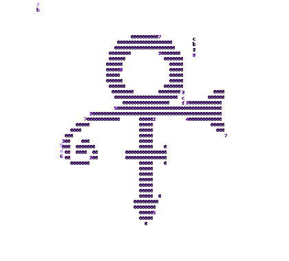

# Purple Rain — setup and publishing

This folder contains the refreshed profile README and its local assets. It preserves the existing Portuguese introduction, learning status, projects note, and Prince performance reference. No new work history, achievements, or repository claims were added.

## Files

```text
github-purple-rain/
├── README.md
├── README-SETUP.md
├── assets/
│   ├── badges/                 # Local SVG badges; no badge service required
│   ├── purple-rain-dark.gif
│   ├── purple-rain-light.gif
│   ├── purple-rain-preview.png
│   ├── ascii-art-original.txt  # Cropped original, kept as a reference
│   └── ascii-art-compact.txt   # Compact art used by the generator
└── scripts/
    └── generate_animation.py
```

## Personalize the profile

1. Edit `README.md` to adjust the short introduction and status line.
2. Keep the technology badges if these are still the technologies you are learning. Each SVG has its label and learning status in its accessible text.
3. Replace the Projects sentence with links and descriptions only when you have real public repositories to highlight.
4. The profile copy is in Portuguese and retains the wording from the existing profile.

## Adjust the ASCII symbol

- `assets/ascii-art-compact.txt` is the 60 × 35 version used by the animation and static fallback. Preserve spaces because they define the shape. `0` is drawn in the main lilac color; other non-space characters are drawn in the accent purple.
- `assets/ascii-art-original.txt` preserves the supplied art after trimming only its blank outer margins. Keep it as a reference or edit the compact file directly.
- The README’s static fallback is the same compact art inside the “Versão estática da arte ASCII” disclosure. Update that code block if you change `ascii-art-compact.txt`.

## Generate or update the animation

The animation is a transparent GIF, which the profile README can display as an image. The generator creates matching dark- and light-theme versions, plus a static PNG preview. It uses a fixed seed by default so the files are reproducible.

Install Python 3 and Pillow, then run from this folder:

```bash
python -m pip install Pillow
python scripts/generate_animation.py
```

Optional controls:

```bash
python scripts/generate_animation.py --density 0.2 --delay-ms 110 --frames 18 --width 420 --height 380 --font-size 8 --seed 29
```

`--density` controls the number of falling streams, `--delay-ms` controls pace, `--frames` sets loop length, `--width` and `--height` set the canvas, `--font-size` changes character size, and `--seed` changes the reproducible rain pattern. The palette is defined near the top of `scripts/generate_animation.py`. The script writes both GIFs and the PNG into `assets/` by default. Use `--symbol` or `--output-dir` to choose different paths.

## Keep the folder structure together

Keep `README.md`, `assets/`, and `scripts/` at the repository root so the image links continue to resolve. The profile README itself needs only `README.md` and `assets/`; `scripts/`, the ASCII source files, and this setup guide are useful for maintaining it.

## Publish on GitHub

1. The profile repository must be **public** and named exactly after your GitHub username. The current `tiagx422/tiagx422` repository already meets this requirement.
2. Put `README.md` in that repository’s root alongside the `assets/` folder.
3. Commit and push the files. GitHub displays the README on your profile when the public repository name matches your username.

The README is installed in `tiagx422/tiagx422` on its `main` branch.

## Check the result

- Preview the Markdown on GitHub before publishing. Confirm the table, `picture` element, SVG badges, GIFs, and fallback disclosure all render.
- Switch GitHub between light and dark themes; the `<picture>` element selects the matching local GIF.
- Check the profile at a narrow viewport. The two-column hero is intentionally compact; if it scrolls horizontally on a phone, replace the table with this stacked hero:

  ```html
  <p align="center">
    <picture>
      <source media="(prefers-color-scheme: dark)" srcset="assets/purple-rain-dark.gif">
      
    </picture>
  </p>

  <h3>PURPLE RAIN<br><sub>perfil de desenvolvimento</sub></h3>
  <p><strong>Aprendendo a construir, uma linha de cada vez.</strong></p>
  <p>Pequenas ideias, prática constante e a atmosfera de um terminal noturno.</p>
  <p><code>STATUS</code><br>aprendendo / construindo / explorando</p>
  ```
- Open `assets/purple-rain-preview.png` to inspect a still frame. The GIF loop is 18 frames at 110 ms per frame and each theme file is about 38 KB in this generated version.
- GitHub profile READMEs support images and GIFs through GitHub Flavored Markdown. GitHub sanitizes rendered HTML, including removing scripts and inline styles, so this project uses plain HTML structure only—no JavaScript, CSS, canvas, or third-party animation service.

## Statistics and external services

I left out third-party contribution and language-stat cards to avoid stale counters and another service dependency. GitHub already shows native activity and repository information on the profile. The five badges are local SVG files, so they do not rely on a badge host.

