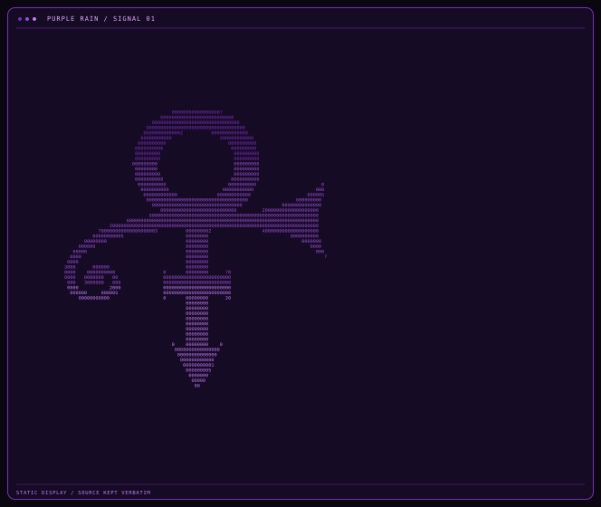

<code>PERFIL&nbsp; / &nbsp;PURPLE RAIN SIGNAL</code>

## Hero principal

<table>
  <tbody>
    <tr>
      <td width="60%" align="center" valign="middle">
        
      </td>
      <td width="40%" valign="middle">
        
<code>TIAGO&nbsp; / &nbsp;@TIAGX422</code>

        <h2>Tiago</h2>
        
Aprendendo a construir, uma linha de cada vez.

        

        
<em>Escrevendo código em tom menor, dando forma a ideias linha por linha.</em>

        
<code>STATUS</code> aprendendo / construindo / explorando

        
<code>FERRAMENTAS EM APRENDIZADO</code> Git · GitHub · JavaScript · Python · MySQL

      </td>
    </tr>
  </tbody>
</table>

  
Ver o ASCII original

  
<a href="assets/purple-rain/ascii-art-source.txt">Abrir o arquivo de texto original</a>

  <pre>                                                                                                                              
                                                                                                                              
                                                                                                                              
                                                                                                                              
                                                                                                                              
                                                                                                                              
                                                                                                                              
                                                                                                                              
                                                                                                                              
                                                                                                                              
                                                                                                                              
                                                                                                                              
                                                                                                                              
                                                                                                                              
                                                                                                                              
                                                       000000000000000007                                                     
                                                   00000000000000000000000000                                                 
                                                0000000000000000000000000000000                                               
                                              90000000000000000000000000000000000                                             
                                             00000000000002          0000000000000                                            
                                            00000000000                 200000000000                                          
                                           0000000000                      0000000000                                         
                                          0000000000                        000000000                                         
                                          000000000                          000000000                                        
                                          000000008                          000000000                                        
                                         000000000                           000000000                                        
                                          00000000                           000000000                                        
                                          000000000                          000000000                                        
                                          0000000008                        0000000000                                        
                                           0000000000                      0000000000                       0                 
                                            0000000000                   00000000000                      000                 
                                             000000000000              000000000000                    000005                 
                                              000000000000000000000000000000000000                 600000000                  
                                                00000000000000000000000000000000              00000000000000                  
                                                   000000000000000000000000000         20000000000000000000                   
                                               500000000000000000000000000000000000000000000000000000000000                   
                                       60000000000000000000000000000000000000000000000000000000000000000000                   
                                 20000000000000000000000000000000000000000000000000000000000000000000000000                   
                             700000000000000000003          000000002                  40000000000000000000                   
                           00000000005                      00000000                             0000000000                   
                        00000000                            00000000                                 0000000                  
                      000000                                00000000                                    0000                  
                    00000                                   00000000                                      000                 
                   0000                                     00000000                                         7                
                  0000                                      00000000                                                          
                 3000      000000                           00000000                                                          
                 0000    0000000000                 0       00000000      70                                                  
                 6000   0000000   00                000000000000000000000000                                                  
                  000   3000000   000               000000000000000000000000                                                  
                  0000           2000               000000000000000000000000                                                  
                   000000     000005                000000000000000000000000                                                  
                      00000000000                   0       00000000      20                                                  
                                                            00000000                                                          
                                                            00000000                                                          
                                                            00000000                                                          
                                                            00000000                                                          
                                                            00000000                                                          
                                                            00000000                                                          
                                                            00000000                                                          
                                                            00000000                                                          
                                                       0    00000000    0                                                     
                                                        0008000000000000                                                      
                                                         00000000000000                                                       
                                                          000000000000                                                        
                                                           00000000001                                                        
                                                            000000005                                                         
                                                             0000000                                                          
                                                              00000                                                           
                                                               00                                                             
                                                                                                                              
                                                                                                                              
                                                                                                                              
                                                                                                                              
                                                                                                                              
                                                                                                                              
                                                                                                                              
                                                                                                                              
                                                                                                                              
                                                                                                                              
                                                                                                                              
                                                                                                                              
                                                                                                                              
                                                                                                                              
                                                                                                                              
</pre>

## Sobre mim

Aprendendo programação e lógica, um projeto de cada vez. Música me inspira a experimentar, praticar e continuar construindo.

## Tecnologias em aprendizado

  
  
  
  
  

## Projetos

Ainda estou começando — em breve vou destacar aqui projetos feitos por mim.

Uma referência à estética de <em>Purple Rain</em> e à energia de palco de Prince. Arte ASCII fornecida por mim; sem afiliação oficial.

<code>END OF SESSION · KEEP BUILDING</code>
