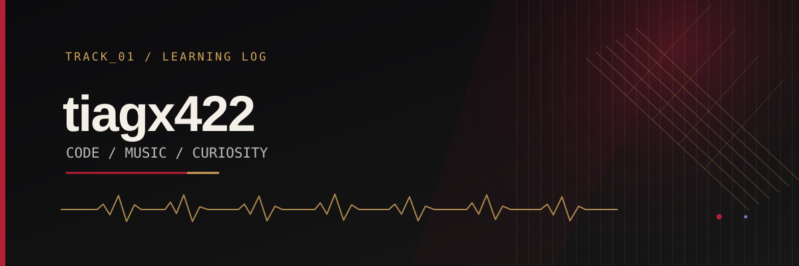
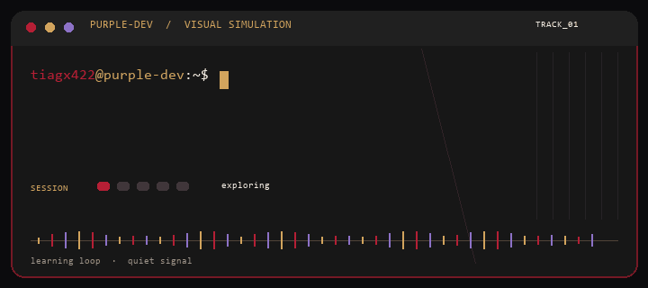

`tiagx422@purple-dev:~$`

### Learning to code. Building with intention.

Exploring programming, logic, and technology one project at a time.

## Animated terminal

Visual simulation, not a live shell: `git status` · `python learning.py` · `node explore.js` · `mysql --learning-mode` · `keep_building --with-intention`.

## About my journey

I'm exploring programming, logic, and technology one small experiment at a time. This profile is a learning log for the foundations I'm building with JavaScript, Python, Git, GitHub, and MySQL. Music and stagecraft remind me to value timing, structure, and restraint.

## Learning stack

- **Version control:** `Git` · `GitHub`
- **Languages:** `JavaScript` · `Python`
- **Database:** `MySQL`

## Projects and experiments

- [PROJECT TITLE] — [one-line description] · [LINK TO REPOSITORY]

## A quiet musical reference

**TRACK_01 / CREATIVE CUE** — Prince's 2004 Rock & Roll Hall of Fame performance of *While My Guitar Gently Weeps*; the restrained red, gold, and purple palette nods to *Purple Rain*. This profile stays silent: no audio or lyrics are embedded.

END OF SESSION · KEEP BUILDING

