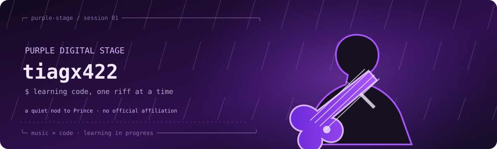

<div align="center">




</div>

```text
      .---------------------------------.
      |  .-------------------------.    |
      |  |   .---.                 |    |
      |  |  / .-. \____            |    |
      |  |  \ `-' /    \___________|===>
      |  |   `---'   o    o         |    |
      |  `-------------------------'    |
      `----._____________________.------'
              \   PURPLE   /\
               `-----------'
                 ~  ~  ~  ~
```

### `tiagx422@purple-stage:~$`

> Aprendendo programação e lógica, um projeto de cada vez. Música me inspira a experimentar, praticar e continuar construindo.

**Explorando agora**

`[ Git ]` · `[ GitHub ]` · `[ JavaScript ]` · `[ Python ]` · `[ MySQL ]`

## Projetos

Ainda estou começando — em breve vou destacar aqui projetos feitos por mim.

<div align="center">

<sub>Uma homenagem visual à energia de palco de Prince e à apresentação de *While My Guitar Gently Weeps* (2004). Arte original; sem afiliação oficial.</sub>

`END OF SESSION · KEEP BUILDING`

</div>
