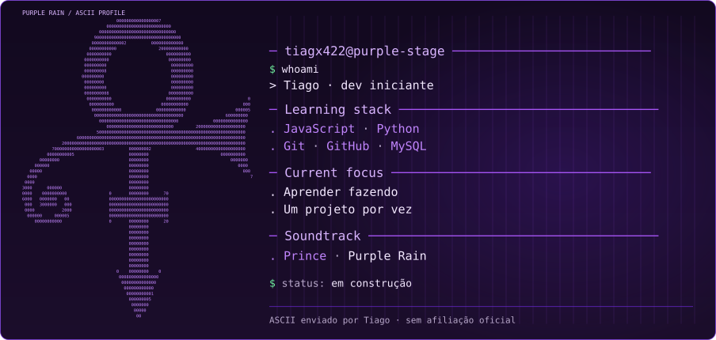

  

  

### Sobre mim

Aprendendo programação e lógica, um projeto de cada vez. Música me inspira a experimentar, praticar e continuar construindo.

**Explorando agora:** `Git` · `GitHub` · `JavaScript` · `Python` · `MySQL`

## Projetos

Ainda estou começando — em breve vou destacar aqui projetos feitos por mim.

Uma referência visual à energia de palco de Prince e à apresentação de *While My Guitar Gently Weeps* (2004). Arte ASCII fornecida por mim; sem afiliação oficial.

`END OF SESSION · KEEP BUILDING`

