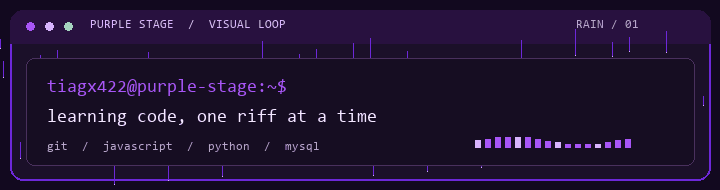

<table>
<tr>
<td valign="top">
<pre>
                         00000000007
                    00000000000000000000
                   0000000000000000000000
                 00000000          20000000
                 000000              0000000
                000000                 00000
                000008                 00000
                00000                  00000
                000000                 00000
                 000000              0000000
                  00000000         00000000            0000
                   00000000000000000000000           000000
                      00000000000000000      2000000000000
                   500000000000000000000000000000000000000
          200000000000000000000000000000000000000000000000
        7000000000000       000002           4000000000000
     00000                  00000                     00000
   0000                     00000                       000
 000                        00000                          7
300    000                  00000
000  0000000                00000    0
 00  0000  00          000000000000000
 00       200          000000000000000
   0000000                  00000    0
                            00000
                            00000
                            00000
                            00000
                            00000
                            00000  0
                          000000000
                          00000000
                            000005
                            00000
                              0
</pre>
</td>
<td valign="top">
<strong><code>tiagx422@purple-stage:~$</code></strong>  
<code>$ whoami</code> 
&gt; Tiago · dev iniciante  
<code>$ learning --stack</code> 
&gt; JavaScript 
&gt; Python 
&gt; Git / GitHub 
&gt; MySQL  
<code>$ current_focus</code> 
&gt; Aprender fazendo 
&gt; um projeto por vez  
<code>$ soundtrack</code> 
&gt; Prince · Purple Rain  
<code>$ status</code> 
&gt; em construção  
[ arte enviada por Tiago ]
</td>
</tr>
</table>

  

### Sobre mim

Aprendendo programação e lógica, um projeto de cada vez. Música me inspira a experimentar, praticar e continuar construindo.

**Explorando agora:** `Git` · `GitHub` · `JavaScript` · `Python` · `MySQL`

## Projetos

Ainda estou começando — em breve vou destacar aqui projetos feitos por mim.

Uma referência visual à energia de palco de Prince e à apresentação de *While My Guitar Gently Weeps* (2004). Arte ASCII fornecida por mim; sem afiliação oficial.

`END OF SESSION · KEEP BUILDING`

